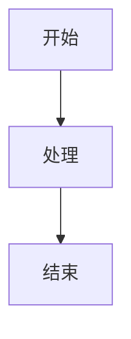

# Spec: <功能名称>

## 状态

- Status: draft
- Owner: TODO
- Created: YYYY-MM-DD
- Related repos: TODO
- Related contracts: TODO
- Related ADRs: TODO

## 背景

TODO

## 问题

TODO

## 目标

- TODO

## 非目标

- TODO

## 用户和角色

| 角色 | 诉求 |
| --- | --- |
| TODO | TODO |

## 用户故事

- 作为 TODO，我希望 TODO，以便 TODO。

## 功能需求

### P0

- TODO

### P1

- TODO

### P2

- TODO

## 输入和输出

### 输入

- TODO

### 输出

- TODO

## 状态和流程

## 边界和约束

- TODO

## 风险

| 风险 | 影响 | 缓解 |
| --- | --- | --- |
| TODO | TODO | TODO |

## 验收标准

- TODO

## 开放问题

- TODO
