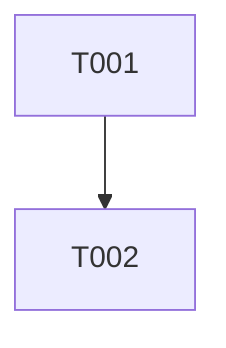

# Tasks: <功能名称>

## 状态

- Status: draft
- Related spec: TODO
- Related plan: TODO

## 任务列表

| ID | 任务 | 仓库 | 可并行 | 完成定义 | 状态 |
| --- | --- | --- | --- | --- | --- |
| T001 | TODO | TODO | yes/no | TODO | pending |

## 执行顺序

## 验证命令

- TODO

## 完成标准

- 所有任务状态为 done。
- checklist 通过。
- evidence 已补齐。
