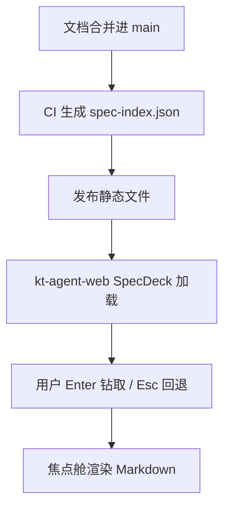

# Spec: SpecDeck：kt-agent-web 需求文档浏览器

## 背景

KT Spec Platform 已落地（kt-backstage SPEC-2026-0001 RFC、kt-specs 中央仓、
kt CLI `spec` 子命令组、frontmatter 契约与状态机）。需求与设计文档有了
统一事实源和 AI 可执行的强范式，但目前只有 CLI 和 Git 两个入口，
缺少面向人的可视化浏览界面。

kt-agent-web 已具备全部交互基础：`GoalDeck` 实现了「Linear 层级 +
Workflowy 下钻（Enter 节点即根，Esc 回上层）」的钻取骨架，
`MarkdownBody`（react-markdown + mermaid）可直接渲染规格文档，
`SkillDeck`/`SkillDetailDrawer` 提供了 Deck + 抽屉的交互先例。

## 问题

- 需求/设计文档无法按「模块 → 需求 → 设计 → 任务 → 证据」逐层浏览，
  层级关系只存在于 frontmatter 字段里，人脑不可见。
- 查看一篇 spec 需要 clone 仓库或开 GitHub 页面，脱离工作台上下文。
- 文档状态（draft/review/approved/...）没有全景视图，无法回答
  「这个模块现在有哪些需求在哪个阶段」。

## 目标

- 在 kt-agent-web 新增 SpecDeck：按模块/需求/设计/任务/证据五层钻取浏览。
- 交互与 GoalDeck 同构：Enter 钻入、Esc 回上层、右侧焦点舱渲染文档全文。
- 状态可视化与 GoalDeck 的 STATE_META 风格一致（色点 + 文案映射）。
- 数据面为 kt-spec-runtime（KT bearer 鉴权）：runtime 直接从 GitHub 拉取
  kt-specs 文档并在进程内构建索引，客户端携带 KT Identity 登录态读取。

## 非目标

- 不做文档编辑（写入口仍是 `kt spec` CLI + PR，见 kt-specs constitution）。
- 不做实时协作、评论（如有需要另立需求）。
- 不在 MVP 接入 Backstage catalog API（L0 模块层先用索引内聚合，P1 再接）。

## 用户和角色

| 角色 | 诉求 |
| --- | --- |
| 开发者 | 在工作台内快速找到自己模块的需求/设计文档，看清上下游 |
| 管理者 | 全景查看各模块需求分布与状态，发现积压（长期 review/draft） |
| AI Agent | 通过同一索引结构定位文档（与 UI 共享数据契约） |

## 用户故事

- 作为开发者，我希望 Enter 钻入「kt-fans-api」模块看到它的全部需求，以便不用切出工作台。
- 作为开发者，我希望钻入一篇 spec 后能继续 Enter 进入它的 plan/tasks，以便沿着链条看全貌。
- 作为管理者，我希望一眼看到状态色点分布，以便发现卡在 review 的需求。
- 作为开发者，我希望 Esc 随时回到上一层，以便不迷路。

## 功能需求

### P0

- `spec-index.json`：kt-specs CI 在 main 合并时生成树状索引（模块 → 文档，
  含 frontmatter 全部字段 + 文档路径 + 正文摘要），发布为静态文件。
- `SpecDeck` 组件：树形钻取（Enter/Esc）、面包屑回溯、状态色点、
  按 kind/status 过滤。
- 焦点舱文档渲染：复用 `MarkdownBody`（含 mermaid），展示 frontmatter 元信息条。

### P1

- L0 模块层接入 Backstage catalog（system/domain 实体）。
- 状态操作入口：焦点舱内触发状态流转（调后端执行 `kt spec status`，走审批）。
- goal ↔ spec 双向关联：GoalNode 可挂 spec_ref，outline 里互相钻取。

### P2

- 移动端适配（MobileApp）。
- 文档全文搜索。
- 需求积压度量（各状态停留时长）。

## 输入和输出

### 输入

- kt-specs 仓 main 分支的文档（requirements/、designs/），由 spec-runtime 拉取。
- KT Identity 会话 bearer（客户端鉴权）。
- （P1）Backstage catalog API、kt-agent-core surface 端点。

### 输出

- 可钻取的文档树 UI；文档全文渲染；状态全景。

## 状态和流程

文档自身的状态机沿用 frontmatter 契约（draft → review → approved →
implementing → shipped），SpecDeck 只读展示，不改状态（P1 才开放操作入口）。

## 边界和约束

- 索引 schema 是 kt-specs（生产方）与 kt-agent-web（消费方）的跨仓库合同，
  变更必须先改 PLAN 中的 schema 节并同步两侧。
- SpecDeck 不直接访问 Git 仓库；只消费索引，保证零鉴权依赖。
- 交互骨架必须复用 GoalDeck 既有模式，不另创交互语言。

## 风险

| 风险 | 影响 | 缓解 |
| --- | --- | --- |
| 索引缓存滞后 | UI 数据不是最新 | runtime 按 TTL 刷新；文档只在合并时变化；页面显示索引生成时间 |
| 索引体积增长 | 加载变慢 | MVP 只含 frontmatter + 摘要；全文按需从文档路径拉取 |
| GoalDeck 骨架耦合目标业务 | 复用困难 | 抽取共用的 outline 钻取原语，不硬改 GoalDeck |

## 验收标准

- SpecDeck 能加载 spec-index.json 并渲染五层树（模块 → spec → plan → tasks → evidence）。
- Enter/Esc 钻取与面包屑回溯可用；状态色点与 GoalDeck 风格一致。
- 焦点舱正确渲染 spec 文档 Markdown（含 mermaid 图）。
- kt-specs CI 合并文档 PR 后索引自动更新。
- 本需求文档自身能在 SpecDeck 中被浏览到（dogfood 闭环）。

## 开放问题

- ~~spec-index.json 静态托管位置~~ 已定：决策 B（kt-spec-runtime 数据面，
  见 PLAN「索引生成」节与 KTAIorg/kt-spec-runtime ADR 0003）。
- P1 状态操作的后端通道（kt-agent-core surface vs spec-runtime 扩展）待评估。
